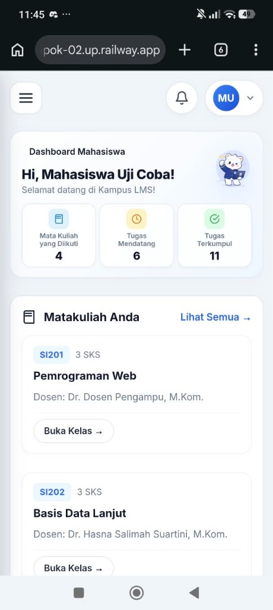
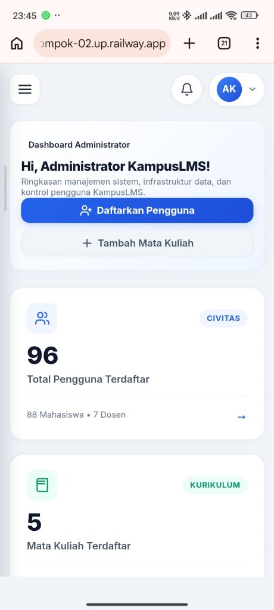
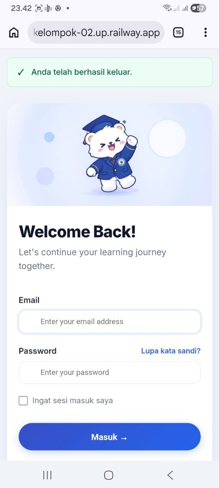
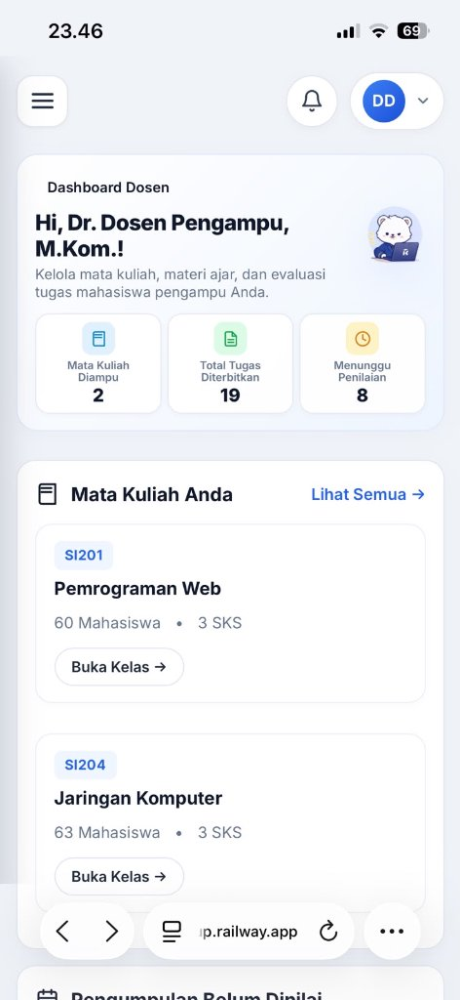

# Dokumentasi Deployment & Panduan Pasca-Deployment (Materi 12)
**KampusLMS - Kelompok 02 | Milestone M4 (Tugas 4 - Bobot 7%)**

---

## 1. Ringkasan Eksekutif & Tautan Live Produksi
Aplikasi web KampusLMS telah berhasil dideploy secara penuh ke lingkungan cloud production menggunakan arsitektur kontainer Docker di atas platform PaaS Railway. Aplikasi ini terhubung ke instance database terkelola MySQL dan reverse proxy TLS/HTTPS.

- **URL Live Produksi:** [https://kampuslms-kelompok-02.up.railway.app](https://kampuslms-kelompok-02.up.railway.app)
- **Alternatif Domain:** [https://kampuslms-kelompok-02-production-ddc2be20.up.railway.app](https://kampuslms-kelompok-02-production-ddc2be20.up.railway.app)
- **Status Deployment:** Active / Production Ready (Centang Hijau)
- **Tanggal Rilis Produksi:** 11 November 2026

---

## 2. Arsitektur & Spesifikasi Server Produksi

| Komponen | Spesifikasi / Konfigurasi | Catatan Implementasi |
|---|---|---|
| **PaaS Provider** | Railway Cloud Platform (PaaS) | Auto-deploy terhubung ke branch `main` GitHub |
| **Container Base** | `php:8.4-apache` (Debian Bookworm) | Menggunakan Apache MPM Prefork |
| **Web Server Root** | `/var/www/html/public` | Isolasi ketat: berkas inti Laravel di luar root |
| **Port Listening** | Dinamis via `$PORT` (Railway standard) | Ditangani skrip startup di Dockerfile |
| **Database Engine** | MySQL 8.0 Managed Cloud Instance | Terhubung via internal variable `${{MySQL...}}` |
| **PHP Extensions** | `pdo_mysql`, `mbstring`, `exif`, `pcntl`, `bcmath`, `gd`, `zip`, `intl` | Termasuk pustaka `libicu-dev` untuk format angka/berkas |
| **Security Layer** | Reverse Proxy SSL Edge + Trust Proxies (`*`) + `URL::forceScheme('https')` | Mencegah mixed content dan kebocoran HTTP |
| **Environment** | `APP_ENV=production`, `APP_DEBUG=false` | Informasi error/stack trace disembunyikan dari publik |

---

## 3. Hasil Security Checklist Audit (BUILD Poin 2)
Pengujian keamanan dilakukan dari luar server menggunakan utilitas `curl -I` untuk membuktikan bahwa berkas-berkas sensitif terlindungi secara fisik oleh web server dan tidak dapat diakses publik.

### A. Uji Kebocoran Berkas `.env` (Kredensial & Kunci Enkripsi)
```bash
curl -I https://kampuslms-kelompok-02.up.railway.app/.env
```
**Output Terminal:**
```http
HTTP/1.1 404 Not Found
Cache-Control: no-cache, private
Content-Type: text/html; charset=utf-8
Date: Wed, 11 Nov 2026 14:39:10 GMT
Server: railway-hikari
x-powered-by: PHP/8.4.27
```
*Evaluasi Keamanan:* **PASS (404 Not Found)**. Konfigurasi `DocumentRoot /var/www/html/public` berhasil menyembunyikan berkas `.env` dari ruang alamat web publik.

### B. Uji Kebocoran Rekaman Error `storage/logs/laravel.log`
```bash
curl -I https://kampuslms-kelompok-02.up.railway.app/storage/logs/laravel.log
```
**Output Terminal:**
```http
HTTP/1.1 404 Not Found
Cache-Control: no-cache, private
Content-Type: text/html; charset=utf-8
Date: Wed, 11 Nov 2026 14:39:37 GMT
Server: railway-hikari
x-powered-by: PHP/8.4.27
```
*Evaluasi Keamanan:* **PASS (404 Not Found)**. Penyerang di internet tidak dapat membaca jejak exception atau jalur direktori server.

### C. Uji Kebocoran Metadata Paket `composer.json`
```bash
curl -I https://kampuslms-kelompok-02.up.railway.app/composer.json
```
**Output Terminal:**
```http
HTTP/1.1 404 Not Found
Cache-Control: no-cache, private
Content-Type: text/html; charset=utf-8
Date: Wed, 11 Nov 2026 14:39:54 GMT
Server: railway-hikari
x-powered-by: PHP/8.4.27
```
*Evaluasi Keamanan:* **PASS (404 Not Found)**. Struktur pustaka internal tertutup rapat.

---

## 4. Hasil Verifikasi Otorisasi & Anti-IDOR Otomatis (BUILD Poin 6)
Skrip audit otorisasi dijalankan langsung menargetkan server produksi:
```bash
bash scripts/test-authz.sh https://kampuslms-kelompok-02.up.railway.app
```

**Rekapitulasi Hasil Pengujian Matriks Keamanan:**
```text
======================================================================
    PENGUJIAN MENYELURUH OTORISASI & KEAMANAN IDOR KAMPUSLMS
======================================================================     
Target Base URL  : https://kampuslms-kelompok-02.up.railway.app

>> 1. Inisialisasi Sesi Pengujian (Admin, Dosen, Mahasiswa)...
  ✓ Sesi otentikasi resmi berhasil disiapkan.

>> 2. Pengujian Akses Dashboard Multi-Peran...
  [PASS] Admin mengakses Dashboard -> HTTP 200 (Sesuai: 200)
  [PASS] Dosen mengakses Dashboard -> HTTP 200 (Sesuai: 200)
  [PASS] Mahasiswa mengakses Dashboard -> HTTP 200 (Sesuai: 200)
  [PASS] Tamu (Guest) mengakses Dashboard (Redirect login) -> HTTP 302 (Sesuai: 302)

>> 3. Pengujian Otorisasi Mata Kuliah...
  [PASS] Admin mengakses form tambah mata kuliah -> HTTP 200 (Sesuai: 200)
  [PASS] Dosen mencoba tambah mata kuliah baru -> HTTP 403 (Sesuai: 403)
  [PASS] Mahasiswa mencoba tambah mata kuliah baru -> HTTP 403 (Sesuai: 403)
  [PASS] Dosen mengakses edit mata kuliah yang diampunya (Course 1) -> HTTP 200 (Sesuai: 200)
  [PASS] Dosen mencoba edit mata kuliah dosen lain (Course 2) -> HTTP 403 (Sesuai: 403)
  [PASS] Mahasiswa mencoba edit mata kuliah -> HTTP 403 (Sesuai: 403)
  [PASS] Mahasiswa melihat mata kuliah yang diikutinya (Course 1) -> HTTP 200 (Sesuai: 200)
  [PASS] Mahasiswa mencoba melihat mata kuliah yang tidak diikutinya (Course 5) -> HTTP 403 (Sesuai: 403)

>> 4. Pengujian CRUD Materi & Tugas...
  [PASS] Dosen membuka form tambah materi pada MK sendiri -> HTTP 200 (Sesuai: 200)
  [PASS] Dosen mencoba tambah materi pada MK dosen lain -> HTTP 403 (Sesuai: 403)
  [PASS] Mahasiswa mencoba tambah materi perkuliahan -> HTTP 403 (Sesuai: 403)
  [PASS] Dosen membuka form buat tugas pada MK sendiri -> HTTP 200 (Sesuai: 200)
  [PASS] Dosen mencoba buat tugas pada MK dosen lain -> HTTP 403 (Sesuai: 403)
  [PASS] Mahasiswa mencoba buat tugas baru -> HTTP 403 (Sesuai: 403)
  [PASS] Mahasiswa mencoba akses tugas berstatus draft (Assignment 3) -> HTTP 403 (Sesuai: 403)
  [PASS] Dosen pengampu mengakses tugas draft miliknya (Assignment 3) -> HTTP 200 (Sesuai: 200)
  [PASS] Mahasiswa mencoba mengumpulkan tugas draft (Assignment 3) -> HTTP 403 (Sesuai: 403)

>> 5. Pengujian IDOR Submission Mahasiswa...
  [PASS] Mahasiswa melihat submission miliknya sendiri (ID 1) -> HTTP 200 (Sesuai: 200)
  [PASS] Mahasiswa mencoba melihat submission mahasiswa lain (ID 2 - IDOR Attack) -> HTTP 403 (Sesuai: 403)
  [PASS] Dosen pengampu memeriksa submission mahasiswa -> HTTP 200 (Sesuai: 200)
  [PASS] Admin memeriksa submission mahasiswa -> HTTP 200 (Sesuai: 200)

>> 6. Pengujian Otorisasi Pengguna & Anti Privilege Escalation...
  [PASS] Admin mengakses daftar pengguna (/users) -> HTTP 200 (Sesuai: 200)
  [PASS] Dosen mencoba akses daftar pengguna (/users) -> HTTP 403 (Sesuai: 403)
  [PASS] Mahasiswa mencoba akses daftar pengguna (/users) -> HTTP 403 (Sesuai: 403)

======================================================================
Total Pengujian  : 28
Lolos (Passed)   : 28
Gagal (Failed)   : 0
======================================================================     
SELURUH PENGUJIAN OTORISASI LOLOS (100% SUKSES)!
```

---

## 5. Ulasan Skrip Deployment `deploy.sh` (BUILD Poin 3)
Berkas `deploy.sh` telah dibuat dengan hak akses executable (`100755`) dan dilengkapi komentar konsekuensi kegagalan pada setiap baris:
1. `set -e`: Menghentikan eksekusi segera saat terjadi kegagalan agar tidak terjadi kompromi data.
2. `php artisan down --secret=...`: Mengaktifkan mode maintenance dengan secret bypass URL sehingga tim DevOps tetap bisa memverifikasi sistem sebelum dibuka untuk umum.
3. `php artisan queue:restart`: Memberitahu worker antrean untuk merestart dirinya agar memuat class code PHP yang baru. Tanpa ini, antrean akan tetap mengeksekusi logika kode lama yang tersimpan di RAM worker.
4. `php artisan migrate --force`: Menjalankan migrasi secara aman di lingkungan produksi tanpa konfirmasi interaktif.
5. Pembersihan dan pembentukan ulang cache (`config:cache`, `route:cache`, `view:cache`): Memastikan performa maksimal dan membaca konfigurasi environment terbaru.
6. Verifikasi HTTP Status sebelum `php artisan up`: Memastikan halaman login mengembalikan HTTP 200 sebelum server keluar dari mode maintenance.

---

## 6. Studi Kasus Penanganan Masalah Produksi (Post-Mortem Troubleshooting)

### Kasus 1: Mixed Content HTTPS pada Reverse Proxy PaaS
- **Gejala:** Tampilan web di browser berantakan (Times New Roman tanpa CSS Tailwind) karena browser memblokir aset `http://.../css/style.css` pada halaman HTTPS.
- **Akar Masalah:** Railway mengakhiri SSL di edge proxy dan meneruskan request via HTTP internal ke Apache. Fungsi `asset()` Laravel mendeteksi request sebagai HTTP biasa.
- **Solusi:**
  1. Menambahkan `$middleware->trustProxies(at: '*')` di `bootstrap/app.php` agar Laravel mengenali header `X-Forwarded-Proto`.
  2. Menambahkan `URL::forceScheme('https')` di `AppServiceProvider.php` untuk lingkungan produksi.

### Kasus 2: Seeder Crash di Mode Produksi (`composer install --no-dev`)
- **Gejala:** Eksekusi `php artisan db:seed --force` crash di baris ke-28 dengan pesan `Class "Faker\Factory" not found`.
- **Akar Masalah:** Pustaka `fakerphp/faker` berada di grup `require-dev` pada `composer.json`, sedangkan Dockerfile menjalankan instalasi dengan bendera `--no-dev`.
- **Solusi:** Memindahkan `fakerphp/faker` ke grup `require` utama dan menyinkronkan blok data di `composer.lock`.

### Kasus 3: Ketiadaan Ekstensi PHP `intl` pada Format Ukuran Berkas
- **Gejala:** Halaman `courses/show` dan `submissions/show` menampilkan HTTP 500 saat diakses mahasiswa dan dosen.
- **Akar Masalah:** Log `storage/logs/laravel.log` mencatat: `The "intl" PHP extension is required to use the [format] method` saat memanggil `\Illuminate\Support\Number::fileSize()`.
- **Solusi:**
  1. Menambahkan fallback perhitungan ukuran file (B, KB, MB) berbasis PHP murni pada model `Material.php` dan `Submission.php` jika ekstensi `intl` tidak terpasang.
  2. Menambahkan pustaka `libicu-dev` dan mengaktifkan ekstensi `intl` pada `Dockerfile`.

---

## 7. Pengujian Responsivitas Mobile Smartphone (BUILD Poin 8)
Aplikasi diuji langsung menggunakan browser ponsel oleh seluruh 4 anggota kelompok untuk memvalidasi tata letak responsif, navigasi hamburger/drawer, dan keterbacaan tabel di layar sentuh kecil:

| No | Penguji | Peran Tim | Perangkat & Browser | Halaman yang Diuji | Hasil Tampilan | Berkas Bukti |
|---|---|---|---|---|---|---|
| 1 | **Chiko Dhiva Pramana** (10241017) | Project Lead & System Architect | Android / Google Chrome | Dashboard Mahasiswa | Responsif, Navbar rapi, Card metrik 1 kolom | `docs/img/mobile-mahasiswa-dashboard.jpg` |
| 2 | **Armansyah** (10241013) | DevOps Executor & Security Auditor | Android / Google Chrome | Dashboard Administrator | Responsif, Tombol aksi mudah ditekan, Statistik rapi | `docs/img/mobile-admin-dashboard.jpg` |
| 3 | **Bella Alviana** (10241015) | Frontend & Mobile Testing | Android / Google Chrome | Halaman Login & Alert | Responsif, Maskot ilustrasi proporsional, Alert rapi | `docs/img/mobile-login-screen.jpg` |
| 4 | **Dawwas Eryansyah Pratama** (10241019) | Frontend & Mobile Testing | iOS (iPhone) / Mobile Safari | Dashboard Dosen | Responsif di WebKit iOS, Menu grid rapi, Status bar pas | `docs/img/mobile-dosen-ios-safari.jpg` |

### Galeri Tangkapan Layar Pengujian Smartphone

<p align="center">
  
  &nbsp;
  
  &nbsp;
  
  &nbsp;
  
</p>

*Keterangan Gambar (Kiri ke Kanan):*
1. **Pengujian 1 (Chiko):** Tampilan Dashboard Mahasiswa pada Android Google Chrome. Menampilkan 3 kartu metrik tugas, navigasi profil, dan daftar mata kuliah aktif tanpa overflow horizontal.
2. **Pengujian 2 (Arman):** Tampilan Dashboard Administrator pada Android Google Chrome. Tombol registrasi pengguna dan metrik civitas kampus tertata rapi.
3. **Pengujian 3 (Bella):** Tampilan Halaman Login dan Alert Notifikasi Keluar pada Android Google Chrome. Form login dan ilustrasi maskot proporsional di layar sentuh.
4. **Pengujian 4 (Dawwas):** Tampilan Dashboard Dosen pada iPhone (iOS Mobile Safari). Membuktikan kompatibilitas lintas mesin peramban (Blink dan WebKit).

