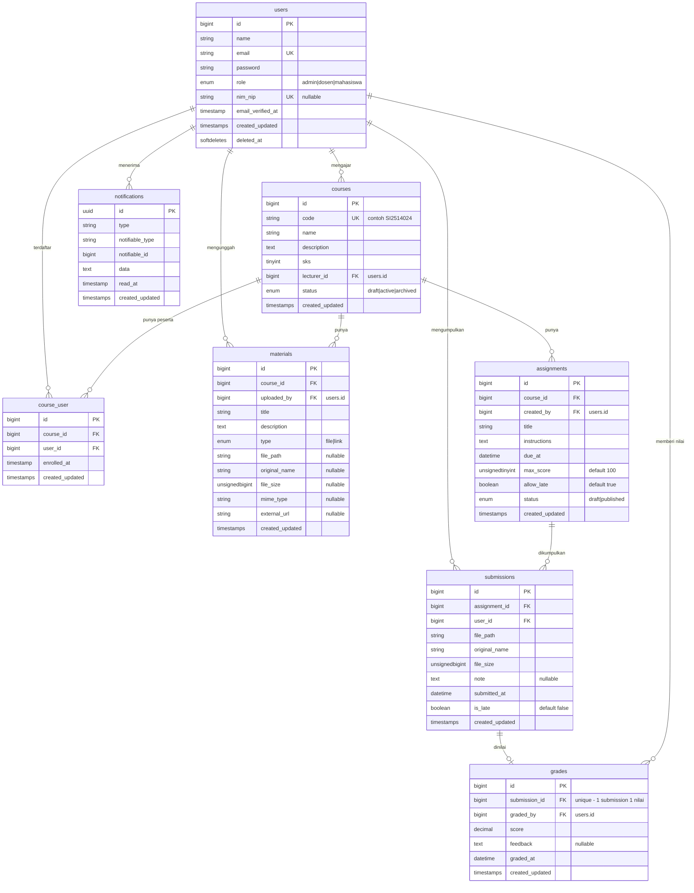

# Catatan Praktikum Minggu 3
**Nama:** Armansyah  
**NIM:** 10241013

## Bagian READ: Analisis Skema Database Sebelum Menulis Kode

### 1. Gambar Ulang ERD Lengkap dari Spesifikasi Proyek  
Di bawah ini adalah pemetaan ERD untuk 8 entitas tabel di KampusLMS. Diagram ini mencakup tipe data, Primary Key (PK), Foreign Key (FK), dan kardinalitas (hubungan antar tabel):

Ringkasan hubungan relasi antar entitas:
1. `users` ke `courses`: Akun dosen dihubungkan ke mata kuliah sebagai pengampu atau pengajar utama.
2. `users` ke `course_user`: Mahasiswa dicatat status pendaftarannya saat mengambil atau mengikuti suatu kelas.
3. `courses` ke `course_user`: Mata kuliah menampung daftar seluruh mahasiswa yang menjadi peserta di kelas tersebut.
4. `courses` ke `materials`: Mata kuliah menjadi wadah penyimpanan khusus untuk menampung file materi pembelajaran.
5. `users` ke `materials`: Dosen dicatat sebagai pihak yang berwenang mengunggah materi ke dalam sistem.
6. `courses` ke `assignments`: Mata kuliah memuat daftar tugas perkuliahan yang wajib dikerjakan oleh peserta.
7. `assignments` ke `submissions`: Tugas yang diterbitkan terhubung dengan seluruh lembar jawaban yang diserahkan oleh peserta.
8. `users` ke `submissions`: Mahasiswa diidentifikasi sebagai pemilik dari setiap lembar jawaban (tugas) yang dikumpulkan ke sistem.
9. `submissions` ke `grades`: Setiap lembar jawaban yang sudah terkumpul akan diproses untuk mendapatkan satu hasil evaluasi penilaian.
10. `users` ke `grades`: Dosen dicatat sebagai pihak evaluator yang memberikan skor dan umpan balik atas tugas.
11. `users` ke `notifications`: Setiap pengguna menerima pesan pemberitahuan otomatis dari sistem terkait aktivitas akademik mereka.

---

### 2. Perilaku `onDelete` pada Foreign Key dan Alasannya

| Tabel | Kolom Foreign Key | Merujuk ke Tabel | Perilaku onDelete | Alasan Pemilihan |
|---|---|---|---|---|
| `courses` | `lecturer_id` | `users.id` | `restrictOnDelete` | Akun dosen tidak boleh dihapus jika masih mengampu mata kuliah aktif agar mata kuliah tidak kehilangan pengajar (mencegah *orphan record*). |
| `course_user` | `course_id` | `courses.id` | `cascadeOnDelete` | Jika mata kuliah dihapus dari sistem, otomatis data kepesertaan mahasiswa di kelas tersebut ikut dibersihkan. |
| `course_user` | `user_id` | `users.id` | `cascadeOnDelete` | Jika akun mahasiswa dihapus dari kampus, pendaftarannya di seluruh mata kuliah otomatis ikut terhapus. |
| `materials` | `course_id` | `courses.id` | `cascadeOnDelete` | Materi melekat langsung pada mata kuliah. Jika mata kuliah dihapus, materi tidak berguna lagi dan harus dihapus agar tidak jadi file sampah. |
| `assignments` | `course_id` | `courses.id` | `cascadeOnDelete` | Tugas perkuliahan adalah bagian dari mata kuliah. Jika mata kuliah dihapus, seluruh tugas di dalamnya otomatis ikut terhapus. |
| `assignments` | `created_by` | `users.id` | `restrictOnDelete` | Dosen pembuat tugas tidak boleh dihapus sembarangan selama tugasnya masih ada demi jejak audit akademik. |
| `submissions` | `assignment_id` | `assignments.id` | `cascadeOnDelete` | Berkas pengumpulan tugas bergantung pada tugasnya. Kalau tugas dihapus, seluruh submission mahasiswa untuk tugas itu otomatis ikut terhapus. |
| `submissions` | `user_id` | `users.id` | `cascadeOnDelete` | Jika akun mahasiswa dihapus, data pengumpulan tugas miliknya ikut terhapus dari sistem. |
| `grades` | `submission_id` | `submissions.id` | `cascadeOnDelete` | Nilai menempel langsung pada lembar tugas mahasiswa. Jika lembar tugas (submission) dihapus, nilainya otomatis terhapus. |
| `grades` | `graded_by` | `users.id` | `restrictOnDelete` | Dosen penilai tidak boleh dihapus jika masih tercatat pernah memberikan nilai demi akuntabilitas riwayat akademik mahasiswa. |

---

### 3. Studi Kasus: Apa yang Terjadi Kalau Akun Dosen Dihapus?      
**Reaksi Sistem:**  
Database akan memblokir perintah delete dan melempar error (Foreign Key Constraint Violation). Intinya: dosen ini tidak bisa dihapus selama namanya masih nyangkut di tabel `courses`.

**Kenapa Dibikin Ketat Begini?**  
Ini soal integritas data. Bayangkan kalau kita pakai aturan `cascade`: saat akun dosen dihapus, seluruh mata kuliah yang dia ajar bakal ikut terhapus otomatis. Mahasiswa yang ambil kelas itu akan kaget karena kelas dan nilainya tiba-tiba hilang dari sistem.
Dengan aturan `restrict`, sistem memaksa admin untuk memindahkan kelas tersebut ke dosen pengganti terlebih dahulu. Setelah kelasnya aman, barulah akun dosen lama bisa dihapus.

---

### 4. Kenapa `submission_id` di Tabel Nilai Pakai `Unique`, Bukan Index Biasa?
**Aturan Bisnis:**  
Satu pengumpulan tugas (lembar jawaban mahasiswa) mutlak hanya boleh diberi satu buah nilai.

**Risiko Kalau Cuma Pakai Index:**  
Index biasa memang bikin query pencarian lebih cepat, tapi tidak mencegah duplikasi data. Kalau cuma pakai index, dosen yang nge-klik tombol "Simpan Nilai" dua kali (atau kalau ada bug di sistem) bisa membuat satu tugas punya dua nilai yang berbeda. Ini akan bikin perhitungan IPK jadi error.

**Solusi Paling Aman (`Unique`):**   
Dengan constraint `unique`, database sendiri yang akan jadi satpam di pintu masuk paling akhir. Meskipun kode backend kita sedang bermasalah atau terjadi klik ganda (race condition), database akan dengan tegas menolak data nilai kedua masuk ke `submission_id` yang sama.