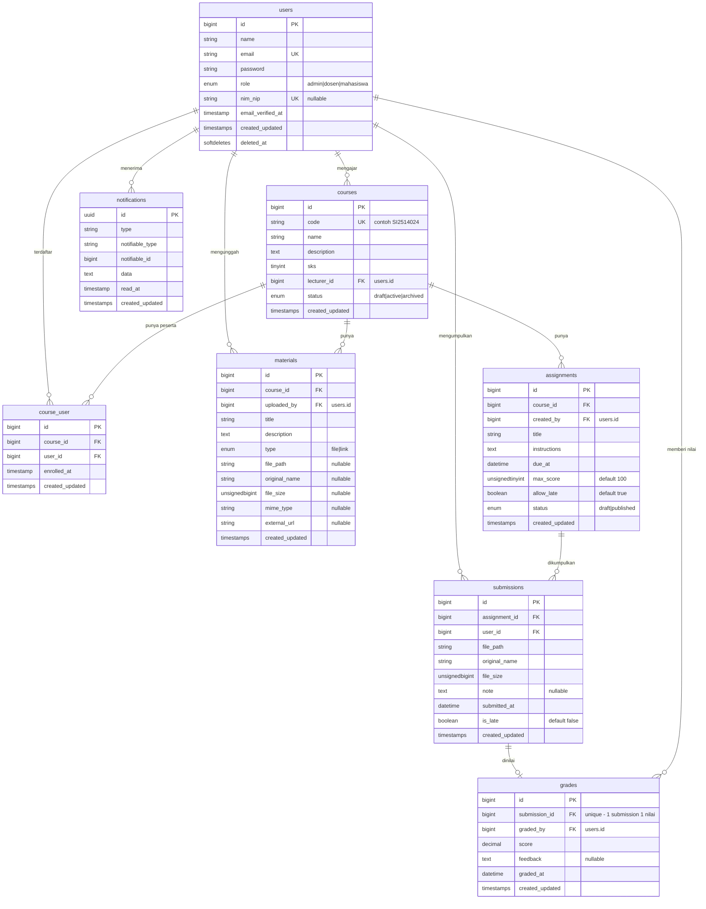

# Minggu 3
**NAMA:** Bella Alviana
**NIM:** 10241015

## READ

**1. Gambar ulang *ERD* dari spesifikasi di papan/kertas, tanpa melihat dokumen.**

Jawab: Berikut adalah gambar ulang ERD keseluruhan KampusLMS dari file spesifikasi proyek (Bagian 4.1), mencakup seluruh 8 entitas tabel beserta tipe data, Primary Key (PK), Foreign Key (FK), dan kardinalitas relasinya:

Ringkasan hubungan relasi antar entitas:
1. `users` ke `courses`: 1 Dosen dapat mengajar banyak mata kuliah (One-to-Many via `lecturer_id`).
2. `users` ke `course_user` dan `courses` ke `course_user`: Relasi Many-to-Many antara Mahasiswa dan Mata Kuliah menggunakan tabel perantara (pivot) `course_user`.
3. `courses` ke `materials`: 1 Mata kuliah memiliki banyak berkas materi (One-to-Many via `course_id`).
4. `courses` ke `assignments`: 1 Mata kuliah memiliki banyak tugas (One-to-Many via `course_id`).
5. `assignments` ke `submissions`: 1 Tugas dapat dikumpulkan oleh banyak mahasiswa (One-to-Many via `assignment_id`).
6. `submissions` ke `grades`: 1 Pengumpulan tugas hanya boleh menerima tepat 1 nilai (One-to-One via `submission_id` unique).
7. `users` ke `grades`: 1 Dosen penilai dapat memberikan banyak penilaian (One-to-Many via `graded_by`).
8. `users` ke `materials`: 1 Dosen pengunggah dapat mengunggah banyak materi (One-to-Many via `uploaded_by`).
9. `users` ke `assignments`: 1 Dosen pembuat dapat menerbitkan banyak tugas (One-to-Many via `created_by`).
10. `users` ke `notifications`: 1 Pengguna dapat menerima banyak notifikasi (Polymorphic One-to-Many).

---

**2. Untuk setiap *foreign key*, tentukan perilaku *onDelete-nya* dan tuliskan alasannya.**

Jawab: 
| Tabel | Kolom Foreign Key | Merujuk ke Tabel | Perilaku onDelete | Alasan Pemilihan |
|---|---|---|---|---|
| `courses` | `lecturer_id` | `users.id` | `restrictOnDelete` | Akun dosen tidak boleh dihapus jika masih mengampu mata kuliah aktif agar mata kuliah tidak kehilangan pengajar (mencegah *orphan record*). |
| `course_user` | `course_id` | `courses.id` | `cascadeOnDelete` | Jika mata kuliah dihapus dari sistem, otomatis data kepesertaan mahasiswa di kelas tersebut ikut dibersihkan. |
| `course_user` | `user_id` | `users.id` | `cascadeOnDelete` | Jika akun mahasiswa dihapus dari kampus, pendaftarannya di seluruh mata kuliah otomatis ikut terhapus. |
| `materials` | `course_id` | `courses.id` | `cascadeOnDelete` | Materi melekat langsung pada mata kuliah. Jika mata kuliah dihapus, materi tidak berguna lagi dan harus dihapus agar tidak jadi file sampah. |
| `assignments` | `course_id` | `courses.id` | `cascadeOnDelete` | Tugas perkuliahan adalah bagian dari mata kuliah. Jika mata kuliah dihapus, seluruh tugas di dalamnya otomatis ikut terhapus. |
| `assignments` | `created_by` | `users.id` | `restrictOnDelete` | Dosen pembuat tugas tidak boleh dihapus sembarangan selama tugasnya masih ada demi jejak audit akademik. |
| `submissions` | `assignment_id` | `assignments.id` | `cascadeOnDelete` | Berkas pengumpulan tugas bergantung pada tugasnya. Kalau tugas dihapus, seluruh submission mahasiswa untuk tugas itu otomatis ikut terhapus. |
| `submissions` | `user_id` | `users.id` | `cascadeOnDelete` | Jika akun mahasiswa dihapus, data pengumpulan tugas miliknya ikut terhapus dari sistem. |
| `grades` | `submission_id` | `submissions.id` | `cascadeOnDelete` | Nilai menempel langsung pada lembar tugas mahasiswa. Jika lembar tugas (submission) dihapus, nilainya otomatis terhapus. |
| `grades` | `graded_by` | `users.id` | `restrictOnDelete` | Dosen penilai tidak boleh dihapus jika masih tercatat pernah memberikan nilai demi akuntabilitas riwayat akademik mahasiswa. |

---

**3. Jawab: kalau seorang dosen dihapus, apa yang terjadi pada mata kuliahnya? Kenapa dirancang begitu?**

Jawab: 
* **Apa yang terjadi:**
  Database akan **menolak perintah penghapusan** dan memunculkan pesan error (*Foreign Key Constraint Violation*). Akun dosen tidak akan bisa dihapus selama ia masih tercatat sebagai pengampu di tabel `courses`.
* **Kenapa dirancang begitu:**
  Untuk melindungi integritas data akademik (*data integrity*). Setiap mata kuliah wajib memiliki dosen penanggung jawab. Jika diatur *cascade*, menghapus satu akun dosen akan membuat seluruh mata kuliah yang dia ampu ikut terhapus, sehingga mahasiswa yang sudah mengambil kelas tersebut akan mendadak kehilangan mata kuliah dan nilai mereka ikut lenyap. 
  Jika seorang dosen berhenti atau pindah, admin wajib memindahkan pengampu mata kuliah ke dosen lain terlebih dahulu, barulah akun dosen lama bisa dihapus dengan aman.

---

**4. Jawab: kenapa *grades.submission_id* bersifat *unique*, bukan sekadar index biasa?**

Jawab: 
* **Alasan utama:**
  Aturan bisnis akademik menetapkan bahwa **1 pengumpulan tugas hanya boleh memiliki 1 nilai** (relasi One-to-One).
* **Risiko jika hanya memakai index biasa:**
  Index biasa hanya mempercepat pencarian, tetapi tetap mengizinkan data ganda. Jika hanya memakai index, dosen (atau sistem karena klik ganda/bug) bisa memasukkan 2 atau 3 nilai berbeda untuk 1 tugas mahasiswa yang sama, sehingga nilai mahasiswa menjadi rancu dan membingungkan sistem rekap IPK.
* **Keuntungan constraint `unique`:**
  Database menjamin secara mutlak di lapisan paling dasar bahwa satu `submission_id` tidak akan pernah bisa dimasuki baris nilai kedua. Upaya memasukkan nilai ganda akan langsung digagalkan oleh database, bahkan jika ada bug di controller atau ada dua request yang masuk bersamaan (*race condition*).

## Break
**1. Hapus unique(`['course_id','user_id']`) dari `course_user`, lalu daftarkan mahasiswa yang sama dua kali.**

Jawab: Hasilnya adalah mahasiswa yang sama berhasil terdaftar dua kali pada mata kuliah yang sama, karena unique(`['course_id', 'user_id']`) berfungsi memastikan kombinasi `course_id` dan `user_id` tidak boleh sama. Jika constraint tersebut dihapus, database tidak lagi mencegah kombinasi yang sama dimasukkan berulang kali atau data enrollment. Jadi Unique composite diperlukan untuk menjaga agar satu mahasiswa hanya memiliki satu enrollment pada satu mata kuliah.

**2. Tambahkan role ke `$fillable` model User, lalu kirim request pembuatan user dengan `role=admin` lewat form yang tidak punya `field role`.**

Jawab: Hasilnya adalah jika request dikirim dengan `role=admin`, nilai `role` tetap dapat diterima dan disimpan, meskipun form yang terlihat oleh pengguna tidak memiliki `field role`. `$fillable` menentukan atribut yang diperbolehkan untuk `mass assignment`. Ketika role dimasukkan ke dalam `$fillable`, Laravel menganggap role sebagai atribut yang boleh diisi melalui `User::create()` atau `update()`. Field seperti `role` sebaiknya tidak dimasukkan ke `$fillable` jika nilainya tidak boleh ditentukan langsung oleh pengguna.

**3. Ganti seluruh `$fillable` dengan protected `$guarded = [];` lalu ulangi nomor 2.**
Jawab: Hasilnya adalah Request dengan `role=admin` juga dapat diterima dan disimpan, bahkan seluruh atribut pada model menjadi terbuka untuk `mass assignment`. `$guarded = []` berarti tidak ada atribut yang dilindungi dari `mass assignment`. Akibatnya, semua atribut yang dikirim melalui request dapat diproses oleh `User::create()` atau `update()`. `$fillable` lebih aman karena kita dapat menentukan secara eksplisit field apa saja yang boleh diisi.

**4. Kosongkan isi `down()` di satu migrasi, lalu jalankan `php artisan migrate:refresh`.**

Jawab: Hasilnya adalah Migration dapat gagal saat proses refresh, terutama ketika migration yang `down()` -nya dikosongkan mencoba dibuat kembali. Sebelumnya `public function down(): void
{
    Schema::dropIfExists('materials');}`kemudian diubah menjadi `public function down(): void
{
}`. Karena `down()` kosong, tabel materials tidak dihapus saat rollback.

**5. Ubah `restrictOnDelete` pada `lecturer_id` menjadi `cascadeOnDelete`, lalu hapus satu dosen.**
Jawab:Hasilnya adalah ketika dosen dihapus, mata kuliah yang menggunakan dosen tersebut juga otomatis terhapus. Untuk data mata kuliah, `restrictOnDelete()` lebih aman karena mencegah penghapusan dosen jika masih digunakan oleh mata kuliah, sehingga data course tidak hilang secara tidak sengaja