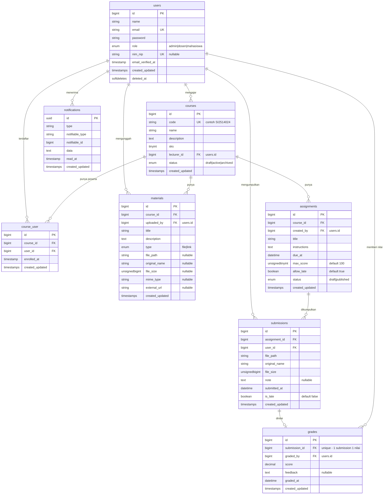

# Catatan Praktikum Minggu 3

**Nama:** Chiko Dhiva Pramana  
**NIM:** 10241017  

---

## Bagian READ: Analisis Skema Database Sebelum Menulis Kode

Pada bagian ini, saya menganalisis perancangan skema database KampusLMS dari file spesifikasi proyek (Bagian 4) sebelum membuat berkas migrasi:

### 1. Gambar Ulang ERD Lengkap dari Spesifikasi Proyek

Berikut adalah gambar ulang ERD keseluruhan KampusLMS dari file spesifikasi proyek (Bagian 4.1), mencakup seluruh 8 entitas tabel beserta tipe data, Primary Key (PK), Foreign Key (FK), dan kardinalitas relasinya:

Ringkasan 11 garis relasi pada diagram ERD spesifikasi:
1. `users` ke `courses`: Dosen "mengajar" mata kuliah (One-to-Many via `lecturer_id`).
2. `users` ke `course_user`: Mahasiswa "terdaftar" pada kelas mata kuliah (One-to-Many).
3. `courses` ke `course_user`: Mata kuliah "punya peserta" mahasiswa (One-to-Many).
4. `courses` ke `materials`: Mata kuliah "punya" berkas materi (One-to-Many via `course_id`).
5. `users` ke `materials`: Dosen "mengunggah" materi (One-to-Many via `uploaded_by`).
6. `courses` ke `assignments`: Mata kuliah "punya" tugas (One-to-Many via `course_id`).
7. `assignments` ke `submissions`: Tugas "dikumpulkan" oleh mahasiswa (One-to-Many via `assignment_id`).
8. `users` ke `submissions`: Mahasiswa "mengumpulkan" tugas (One-to-Many via `user_id`).
9. `submissions` ke `grades`: Pengumpulan tugas "dinilai" (One-to-One via `submission_id` unique).
10. `users` ke `grades`: Dosen "memberi nilai" (One-to-Many via `graded_by`).
11. `users` ke `notifications`: Pengguna "menerima" notifikasi (One-to-Many).

*(Catatan: Pada diagram ERD, tugas melekat langsung pada mata kuliah melalui `courses punya assignments`. Kolom `created_by` di tabel `assignments` berfungsi sebagai pencatat audit siapa dosen yang membuat tugas tersebut).*

---

### 2. Perilaku `onDelete` pada Foreign Key dan Alasannya

| Tabel | Kolom Foreign Key | Merujuk ke Tabel | Perilaku onDelete | Alasan Pemilihan |
|---|---|---|---|---|
| `courses` | `lecturer_id` | `users.id` | `restrictOnDelete` | Akun dosen tidak boleh dihapus jika masih mengampu mata kuliah aktif agar mata kuliah tidak kehilangan pengajar (mencegah *orphan record*). |
| `course_user` | `course_id` | `courses.id` | `cascadeOnDelete` | Jika mata kuliah dihapus dari sistem, otomatis data kepesertaan mahasiswa di kelas tersebut ikut dibersihkan. |
| `course_user` | `user_id` | `users.id` | `cascadeOnDelete` | Jika akun mahasiswa dihapus dari kampus, pendaftarannya di seluruh mata kuliah otomatis ikut terhapus. |
| `materials` | `course_id` | `courses.id` | `cascadeOnDelete` | Materi melekat langsung pada mata kuliah. Jika mata kuliah dihapus, materi tidak berguna lagi dan harus dihapus agar tidak jadi file sampah. |
| `assignments` | `course_id` | `courses.id` | `cascadeOnDelete` | Tugas perkuliahan adalah bagian dari mata kuliah. Jika mata kuliah dihapus, seluruh tugas di dalamnya otomatis ikut terhapus. |
| `assignments` | `created_by` | `users.id` | `restrictOnDelete` | Dosen pembuat tugas tidak boleh dihapus sembarangan selama tugasnya masih ada demi jejak audit akademik. |
| `submissions` | `assignment_id` | `assignments.id` | `cascadeOnDelete` | Berkas pengumpulan tugas bergantung pada tugasnya. Kalau tugas dihapus, seluruh submission mahasiswa untuk tugas itu otomatis ikut terhapus. |
| `submissions` | `user_id` | `users.id` | `cascadeOnDelete` | Jika akun mahasiswa dihapus, data pengumpulan tugas miliknya ikut terhapus dari sistem. |
| `grades` | `submission_id` | `submissions.id` | `cascadeOnDelete` | Nilai menempel langsung pada lembar tugas mahasiswa. Jika lembar tugas (submission) dihapus, nilainya otomatis terhapus. |
| `grades` | `graded_by` | `users.id` | `restrictOnDelete` | Dosen penilai tidak boleh dihapus jika masih tercatat pernah memberikan nilai demi akuntabilitas riwayat akademik mahasiswa. |

---

### 3. Kasus Jika Dosen Dihapus: Apa yang Terjadi dan Kenapa Dirancang Begitu?

* **Apa yang terjadi:**
  Database akan **menolak perintah penghapusan** dan memunculkan pesan error (*Foreign Key Constraint Violation*). Akun dosen tidak akan bisa dihapus selama ia masih tercatat sebagai pengampu di tabel `courses`.
* **Kenapa dirancang begitu:**
  Untuk melindungi integritas data akademik (*data integrity*). Setiap mata kuliah wajib memiliki dosen penanggung jawab. Jika diatur *cascade*, menghapus satu akun dosen akan membuat seluruh mata kuliah yang dia ampu ikut terhapus, sehingga mahasiswa yang sudah mengambil kelas tersebut akan mendadak kehilangan mata kuliah dan nilai mereka ikut lenyap. 
  Jika seorang dosen berhenti atau pindah, admin wajib memindahkan pengampu mata kuliah ke dosen lain terlebih dahulu, barulah akun dosen lama bisa dihapus dengan aman.

---

### 4. Kenapa `grades.submission_id` Bersifat Unique, Bukan Sekadar Index Biasa?

* **Alasan utama:**
  Aturan bisnis akademik menetapkan bahwa **1 pengumpulan tugas hanya boleh memiliki 1 nilai** (relasi One-to-One).
* **Risiko jika hanya memakai index biasa:**
  Index biasa hanya mempercepat pencarian, tetapi tetap mengizinkan data ganda. Jika hanya memakai index, dosen (atau sistem karena klik ganda/bug) bisa memasukkan 2 atau 3 nilai berbeda untuk 1 tugas mahasiswa yang sama, sehingga nilai mahasiswa menjadi rancu dan membingungkan sistem rekap IPK.
* **Keuntungan constraint `unique`:**
  Database menjamin secara mutlak di lapisan paling dasar bahwa satu `submission_id` tidak akan pernah bisa dimasuki baris nilai kedua. Upaya memasukkan nilai ganda akan langsung digagalkan oleh database, bahkan jika ada bug di controller atau ada dua request yang masuk bersamaan (*race condition*).

## Bagian BREAK: Lima Kerusakan

1. Prediksi: data yang sama akan tetap bisa didaftarkan, karena tidak ada validasi identitas uniknya
**sebenarnya:** database meloloskannya tanpa ada keluhan atau error sama sekali.

2. Prediksi: user biasa akan mendapatkan hak akses admin sembarangan
**sebenarnya:** input `role` langsung diterima dan disimpan ke database, sehingga akun baru tersebut langsung menjadi admin tanpa verifikasi hak akses.

3. Prediksi: Jika `$fillable` diganti `$guarded = [],` semua kolom di tabel terbuka bebas tanpa filter whitelist, sehingga perlindungan mass assignment mati total dan siapa saja bisa mengisi kolom sensitif apa pun (seperti role).
**sebenarnya:** seluruh proteksi mass assignment mati total. Data role 'admin' langsung lolos dan masuk ke database tanpa ada penyaringan kolom sama sekali.

4. Prediksi: Jika isi fungsi down() dikosongkan, Laravel tidak akan menghapus tabel saat proses rollback. Akibatnya, saat migrate:refresh mencoba membuat ulang tabel tersebut lewat up(), proses akan gagal (error) karena tabelnya masih ada di database.
**sebenarnya:** proses rollback gagal dengan error foreign key constraint (tabel `users` tidak bisa di-drop karena tabel `courses` masih ada dan merujuk ke tabel `users`). Migrasi terbukti tidak reversible.

5. Prediksi: Jika restrictOnDelete diubah menjadi cascadeOnDelete pada relasi dosen, menghapus akun dosen akan memicu efek domino di database, di mana mata kuliah yang diampu dosen tersebut akan ikut lenyap terhapus secara otomatis.
**sebenarnya:** mata kuliah Pak Budi ikut terhapus dari database (output Course::find menghasilkan null). Terjadi kehilangan data berantai akibat efek cascade delete.

## Checkpoint Minggu 3:

1. **Tunjukkan migrasi yang Anda tulis. Jelaskan setiap constraint di dalamnya:**
   Contoh pada migrasi `courses` dan `course_user`:
   - `code`: diberi `unique()` supaya kode mata kuliah tidak ada yang kembar.
   - `lecturer_id`: pakai `restrictOnDelete()` supaya akun dosen tidak bisa dihapus jika masih ada mata kuliah yang dia ampu.
   - `unique(['course_id', 'user_id'])` di tabel pivot `course_user`: menjamin satu mahasiswa tidak bisa terdaftar dua kali di mata kuliah yang sama.
   - `cascadeOnDelete()` di materi dan tugas: kalau mata kuliah dihapus, materi dan tugas di dalamnya otomatis ikut terhapus bersih oleh database.

2. **Kenapa `course_user` punya unique composite? Peragakan apa yang terjadi kalau dihapus:**
   - **Tujuannya:** Menjaga agar mahasiswa tidak terdaftar dobel di mata kuliah yang sama. Pengecekan di controller saja bisa tembus kalau mahasiswa klik tombol simpan berulang kali dengan cepat (race condition). Database adalah benteng pertahanan terakhir.
   - **Hasil saat dihapus (uji coba BREAK 1):** Saat constraint ini saya matikan sementara di Tinker, mahasiswa yang sama berhasil terdaftar dua kali di mata kuliah yang sama tanpa ada pesan error apa pun dari database.

3. **Apa itu mass assignment? Tunjukkan di kode Anda apa yang mencegahnya, lalu peragakan serangannya:**
   - **Pengertian:** Mass assignment adalah celah keamanan saat input form langsung dimasukkan sekaligus ke database tanpa disaring. Bahayanya, user bisa menyelipkan field terlarang (misalnya `role=admin`).
   - **Pencegahannya di kode:**
     1. Di model `User.php`, field `role` tidak dimasukkan ke `$fillable`.
     2. Di `UserController.php`, kita mengisi role secara terpisah (`$user->role = $validated['role']`), bukan pakai `$request->all()`.
   - **Peragaan serangan:** Di eksperimen BREAK 2, saat `role` sengaja saya masukkan ke `$fillable`, user biasa yang mengirim payload `'role' => 'admin'` langsung otomatis berubah menjadi admin.

4. **Kenapa `role` tidak boleh ada di `$fillable`? Di mana ia diisi sebagai gantinya:**
   - **Alasan:** Kalau `role` ada di `$fillable`, user biasa bisa menyisipkan field `role=admin` saat pendaftaran akun dan langsung punya hak akses admin tanpa izin.
   - **Tempat pengisiannya:** `role` diisi secara eksplisit di `UserController.php` lewat baris `$user->role = $validated['role']` setelah datanya divalidasi.

5. **Kenapa `lecturer_id` memakai `restrictOnDelete` sementara `materials.course_id` memakai `cascadeOnDelete`:**
   - Dosen pakai `restrictOnDelete` karena akun dosen yang masih aktif mengajar tidak boleh asal dihapus, supaya mata kuliah dan riwayat nilai mahasiswa tidak hilang berantakan.
   - Materi pakai `cascadeOnDelete` karena materi menempel pada mata kuliah. Kalau mata kuliahnya resmi dihapus, materinya otomatis sudah tidak terpakai lagi, jadi wajar langsung dibersihkan oleh database.

6. **Jalankan `php artisan migrate:refresh` di depan penguji:**
   - Sudah dijalankan dan sukses 100% tanpa error.
   - Semua tabel berhasil dihapus lewat method `down()`, lalu dibuat ulang lewat method `up()`. Ini membuktikan seluruh migrasi bersifat reversible dan file migrasi tidak ada yang rusak.

7. **Tunjukkan satu bagian kode yang Anda tulis dengan bantuan AI. Apa yang Anda ubah dari keluaran aslinya, dan kenapa:**
   - **Contoh 1 (Casting Laravel 12):** AI awalnya memberikan casting model gaya lama Laravel 10 (`protected $casts = [...]`). Saya ubah menjadi method standar Laravel 12 yaitu `protected function casts(): array`.
   - **Contoh 2 (Nilai Enum Bahasa Indonesia):** Saat generate factory dan seeder, AI sempat memakai nilai bahasa Inggris (`'lecturer'` dan `'student'`). Saya ubah menjadi `'dosen'` dan `'mahasiswa'` agar sesuai dengan skema migrasi dan tidak menyebabkan error data truncated di MySQL.

